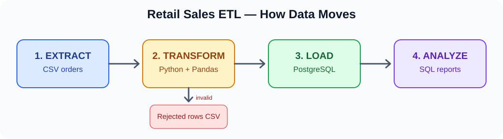
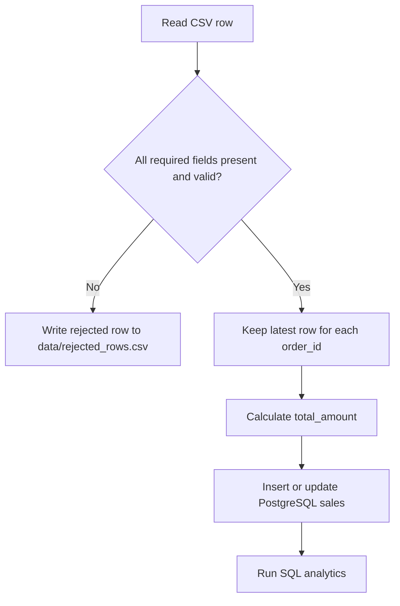
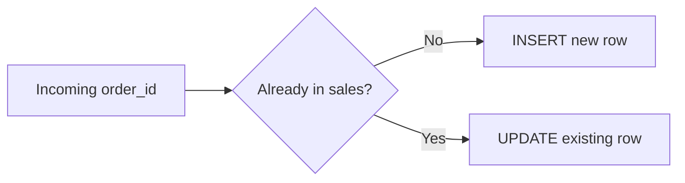
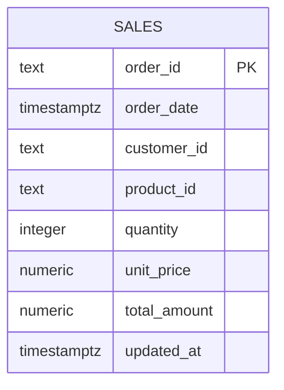

# Retail Sales ETL — Visual Beginner-Friendly Guide

> **Who is this for?** Anyone learning data engineering, including the author of this project. Start here before reading the Python code.

## 1. What does this project do?

Imagine a store exports its daily orders as a spreadsheet. Before analysts can trust it, someone must check for errors and save it into a database. **This project does exactly that.**



**ETL** means **Extract → Transform → Load**:

| Step | Everyday meaning | This project |
|---|---|---|
| Extract | Read the source | Read `data/sample_sales.csv` with Pandas |
| Transform | Clean and check | Validate dates, IDs, quantity, price; remove duplicate order IDs |
| Load | Save to database | Insert/update rows in PostgreSQL |
| Analyze | Answer business questions | Run `sql/analytics.sql` |

## 2. Follow one order through the pipeline

Example input CSV:

```csv
order_id,order_date,customer_id,product_id,quantity,unit_price
ORD-0001,2026-01-02,C002,P002,2,17.49
```

**Transformation:** `total_amount = quantity × unit_price = 2 × 17.49 = 34.98`.

The cleaned record is loaded into the `sales` table. An analyst can then query revenue per month, best-selling products, and repeat customers.

## 3. What happens when data is bad?



Examples of rejected rows: a blank customer ID, invalid order date, quantity `-2`, quantity `1.5`, or negative price. The rejects file is generated locally and intentionally excluded from Git.

**Important:** The pipeline rejects invalid rows; it does not silently fix all problems. If a required *column* is missing, the pipeline stops with an error.

## 4. Where is everything?

| File | What it is | Read it when... |
|---|---|---|
| `data/sample_sales.csv` | 100 synthetic retail orders | You want to see the input |
| `src/retail_etl/cli.py` | Pipeline entry point | You want to see the steps in order |
| `src/retail_etl/transform.py` | Cleaning and validation | You want to understand data quality |
| `src/retail_etl/db.py` | Database table and upsert | You want to understand loading |
| `sql/analytics.sql` | Reporting queries | You want to analyze the results |
| `tests/test_transform.py` | Automated transformation tests | You want to see how code is checked |
| `docker-compose.yml` | Local PostgreSQL container | You want to run the database |
| `.github/workflows/ci.yml` | GitHub Actions tests and lint | You want to understand CI |

## 5. Run it on your own computer

### Prerequisites

Install **Python 3.11+**, **Docker Desktop**, and **Git**. Start Docker Desktop before running the database.

### Step A — Download the code

```bash
git clone https://github.com/saginalarakku21/retail-sales-etl-pipeline.git
cd retail-sales-etl-pipeline
```

### Step B — Create your Python environment

**macOS / Linux:**

```bash
python3 -m venv .venv
source .venv/bin/activate
cp .env.example .env
pip install -e '.[dev]'
```

**Windows PowerShell:**

```powershell
py -3 -m venv .venv
.\.venv\Scripts\Activate.ps1
Copy-Item .env.example .env
pip install -e ".[dev]"
```

### Step C — Start PostgreSQL

```bash
docker compose up -d
```

### Step D — Run the ETL

```bash
retail-etl --input data/sample_sales.csv
```

Expected behavior: logs report **100 loaded rows and 0 rejected rows** for the supplied sample, assuming the database is available. This is an expected outcome, not a verified runtime result.

### Step E — Explore your data

```bash
docker compose exec postgres psql -U retail -d retail -c "SELECT COUNT(*) FROM sales;"
```

Expected count: `100`. Then run the analytics:

```bash
docker compose exec -T postgres psql -U retail -d retail -f /dev/stdin < sql/analytics.sql
```

**Windows PowerShell alternative:** Open `sql/analytics.sql` and run its SQL statements in a PostgreSQL client, or pipe the file with `Get-Content sql/analytics.sql | docker compose exec -T postgres psql -U retail -d retail`.

### Step F — Run tests

```bash
pytest -q
ruff check src tests
```

## 6. What is an upsert? Why does it matter?

An **upsert** means *insert if new; update if the order already exists*. The `order_id` is a primary key, so the same order cannot be stored twice.



Try running the same CSV twice and checking `SELECT COUNT(*) FROM sales;`. The count should remain **100**, not 200. This property is called **idempotency**.

## 7. How the database is organized



This demo uses one table. In a larger warehouse, you might create separate customers, products, and fact-sales tables.

## 8. Interview-ready explanation

> “I built a retail sales ETL pipeline using Python, Pandas, SQLAlchemy, and PostgreSQL. It reads CSV orders, validates required fields, quarantines invalid records, deduplicates order IDs, calculates revenue, and transactionally upserts the cleaned rows. I added SQL reporting queries, pytest unit tests, Docker Compose for a local database, and GitHub Actions CI.”

## 9. Troubleshooting

| Problem | What to try |
|---|---|
| `docker` not found | Install and start Docker Desktop |
| Connection refused on port 5432 | Run `docker compose up -d`; check `docker compose ps` |
| Port 5432 already in use | Stop the other PostgreSQL instance or change the mapped port and `.env` |
| `retail-etl` not found | Activate the virtual environment and run `pip install -e '.[dev]'` |
| `DATABASE_URL must be set` | Copy `.env.example` to `.env` |
| CSV column error | Check the six required CSV headers |
| GitHub Actions fails | Open the Actions tab, click the failed job, and read its log |

## 10. What to learn next

1. **SQL:** Practice `SELECT`, `GROUP BY`, `JOIN`, `HAVING`.
2. **Python:** Read `transform.py` and change a test input.
3. **PostgreSQL:** Learn constraints, transactions, and `ON CONFLICT`.
4. **Production ETL:** Add batch IDs, audit logs, incremental loads, and orchestration.

**Note:** The dataset is synthetic, and this is a learning portfolio project—not a production-grade financial ledger. The sample code uses floating-point Pandas arithmetic before loading rounded numeric values; production financial pipelines should use exact decimal arithmetic.
